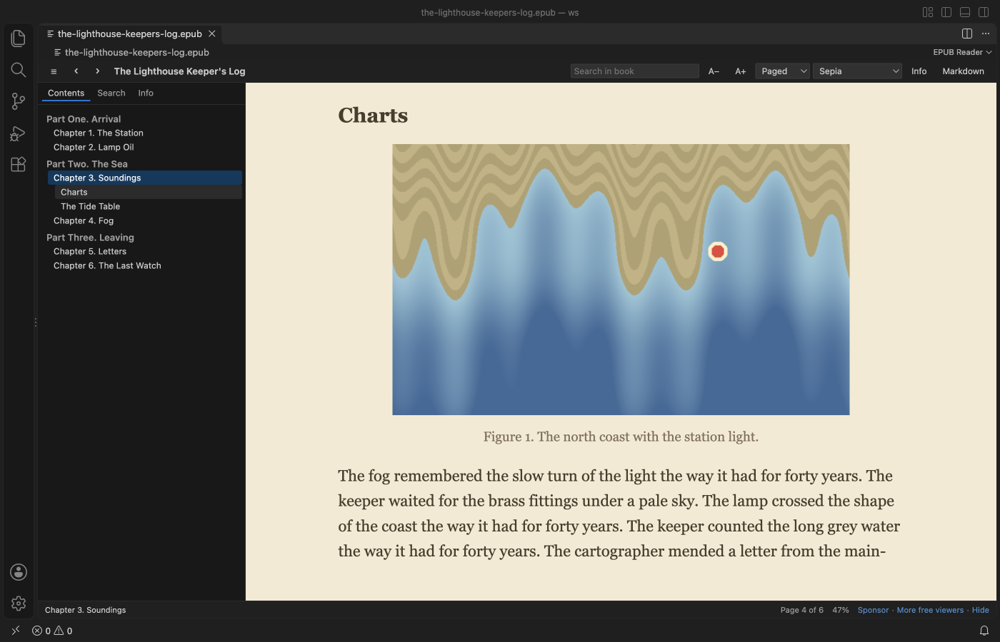
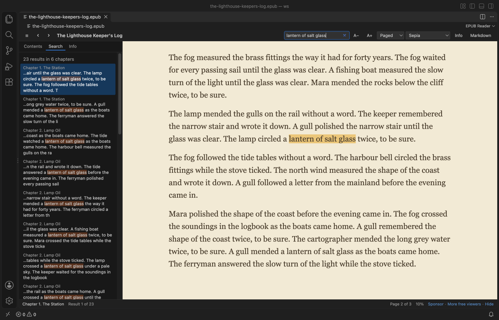
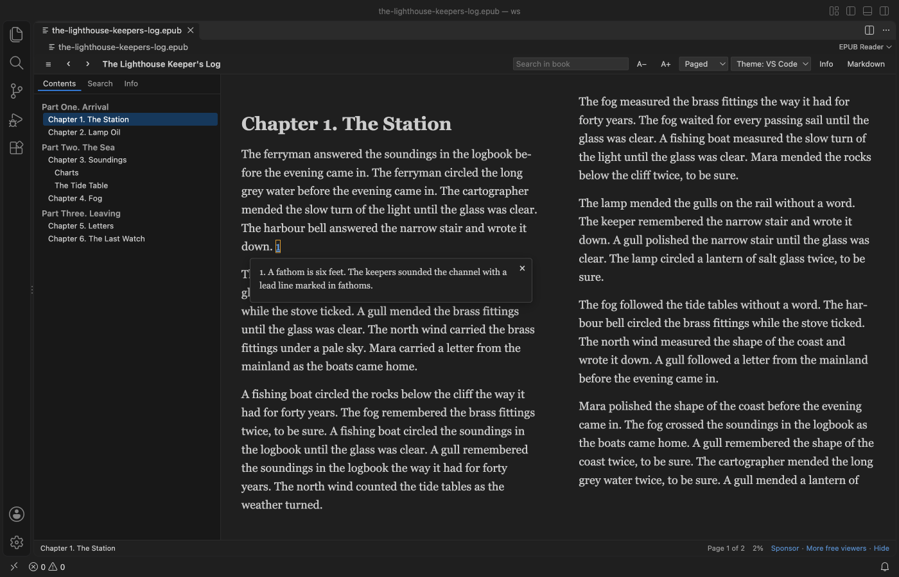
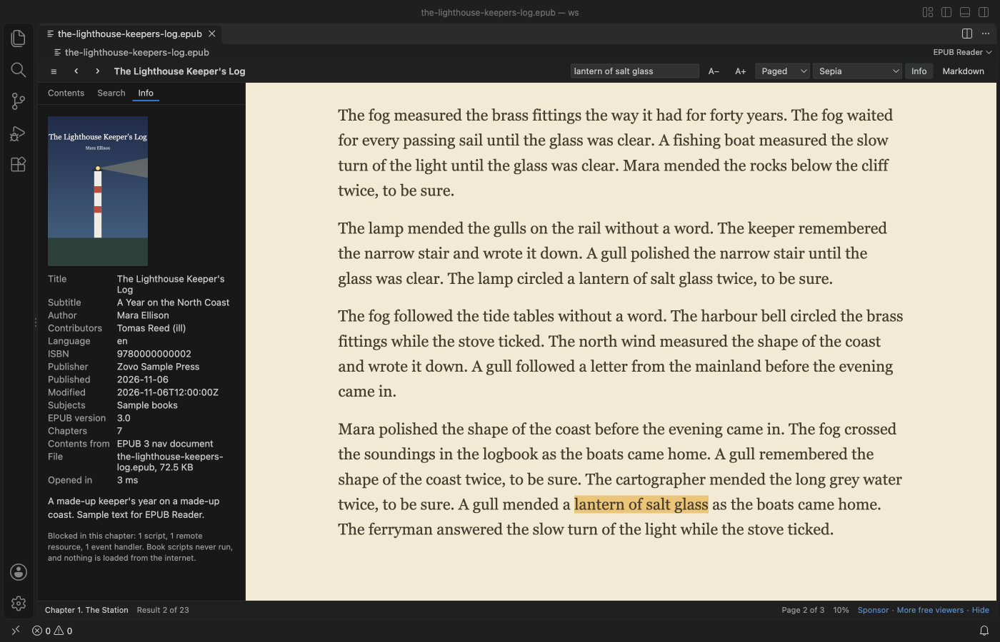
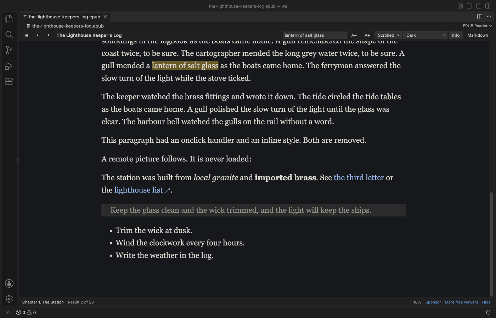

# EPUB Reader & EPUB Viewer

Read EPUB books in a VS Code tab, with pages or scrolling, a table of contents, search, footnote popups and a sepia or dark theme.

*Screenshot of VS Code 1.142 with a sample book made by `scripts/make-samples.js`.*

- Read the way you like. Turn pages like a book (two columns in a wide editor) or scroll each chapter, in your VS Code colors, light, sepia or dark.
- Find things fast. Search the whole book, click a note number to read the footnote in a popup, and jump anywhere from the contents.
- Pick up where you stopped. Each book opens at your last page, and book scripts never run.

## Quick start

1. Install the extension.
2. Click any `.epub` file in the Explorer.

## What you can do

| Action | How |
|---|---|
| Turn pages | Right and Left arrows, Page Down and Page Up, Space, the mouse wheel, or a click on the right or left edge of the page. |
| Jump to a chapter | The Contents button at the left end of the toolbar opens the list. EPUB 3 nav and EPUB 2 NCX lists are both read, with nested parts and sections. |
| Search the book | Type in "Search in book" and press Enter. Every match is listed with its chapter and highlighted in the text. Enter goes to the next match and Shift+Enter to the one before. |
| Read a footnote | Click the note number. The note opens in a popup, even when it lives in a separate notes file. Escape closes it. |
| Change the look | Theme (VS Code, Light, Sepia, Dark), A− and A+ for the text size, and Paged or Scrolled. Your choice is kept for every book. |
| See book details | Info shows the cover, title, author, language, ISBN, publisher, dates and EPUB version. |
| Save a chapter as Markdown | Markdown in the toolbar asks where to save the `.md` file and writes the chapter's images into a folder next to it. |

## Safe to open any book

- The book's HTML goes through an allow-list before it is shown. Scripts, event handlers, forms, frames, inline styles and remote images or style sheets are removed.
- The viewer page has a strict Content Security Policy as a second wall. Only its own script runs, and nothing can load from the internet.
- Links to websites open in your browser only when you click them.
- Books protected with DRM can't be read, and they get a clear message instead of garbled text.

## Big books

Only the parts of the book you open are read from disk. A 400-chapter test book opened in about a second, and a search of the whole book took under half a second. Books over 200 MB show a message and are not read (setting `epubReader.maxFileMB`).

## Settings

| Setting | Default | What it does |
|---|---|---|
| `epubReader.flow` | `paged` | `paged` or `scrolled` reading. |
| `epubReader.theme` | `auto` | `auto` uses your VS Code colors. Also `light`, `sepia` and `dark`. |
| `epubReader.fontSize` | `18` | Text size in pixels, 10 to 40. |
| `epubReader.fontFamily` | `serif` | `serif` or `sans`. |
| `epubReader.footnotePopups` | `true` | Footnotes open in a popup and EPUB 3 footnote boxes are hidden from the page. |
| `epubReader.rememberPosition` | `true` | Each book opens where you stopped. Positions stay on this computer. |
| `epubReader.maxFileMB` | `200` | Largest book to open. |
| `epubReader.askForRating` | `true` | Ask one time for a Marketplace rating after a few days of use. |
| `epubReader.showSupportLinks` | `true` | Show the small Sponsor and More free viewers links in the status line. |

## Privacy

No telemetry and no network calls. Books are read on your computer, reading positions are kept in VS Code's local storage, and the only file the extension writes is a Markdown export you asked for.

## Limits

- The book's own style sheet is not applied, so the reading themes and text size work in every book. Fonts embedded in the book are not used.
- Fixed-layout books (comics, picture books) are shown as flowing pages, so their page design is lost.
- Audio, video and inline SVG drawings are not shown. An SVG cover or picture shown as an image works.
- Search finds text inside one chapter at a time, so a phrase split across two chapters is not found.
- DRM-protected books can't be opened.

## Support

Zovo extensions have no ads and no tracking, and sponsors pay for the time that goes into fixes and new viewers. You can sponsor the work on [GitHub Sponsors](https://github.com/sponsors/theluckystrike).

## More viewers by Zovo

- [PDF Viewer & PDF Reader with Dark Mode](https://marketplace.visualstudio.com/items?itemName=zovo.pdf-viewer-dark) reads PDFs with a real dark mode, search, an outline and thumbnails.
- [DOCX Viewer & Word Viewer with Dark Mode](https://marketplace.visualstudio.com/items?itemName=zovo.docx-viewer-vscode) previews Word and ODT files with dark mode, an outline and search.
- [CSV Viewer, Excel Viewer & Parquet Viewer](https://marketplace.visualstudio.com/items?itemName=zovo.table-viewer-vscode) opens CSV, TSV, Excel and Parquet files as a sortable, filterable table.
- [PPTX Viewer & PowerPoint Viewer](https://marketplace.visualstudio.com/items?itemName=zovo.pptx-slide-viewer) shows PowerPoint slides, thumbnails and speaker notes.
- [Large JSON Viewer & JSON Tree](https://marketplace.visualstudio.com/items?itemName=zovo.zovo-json-tree-viewer) shows large JSON files as a searchable tree, copies JSONPath and turns arrays of objects into a table.
- [JSONL Viewer & NDJSON Table Viewer](https://marketplace.visualstudio.com/items?itemName=zovo.zovo-jsonl-viewer) opens JSONL and NDJSON files as a table, as records or as a chat view.
- [SQLite Viewer & DB Viewer (Read-Only)](https://marketplace.visualstudio.com/items?itemName=zovo.sqlite-table-viewer) browses SQLite tables read-only and runs SELECT queries.
- [HDF5 & NetCDF Explorer (H5 Viewer)](https://marketplace.visualstudio.com/items?itemName=zovo.hdf5-netcdf-explorer) browses groups, attributes and values in HDF5 and NetCDF files and plots slices.
- [GGUF, Safetensors & NPY Viewer (NumPy Viewer)](https://marketplace.visualstudio.com/items?itemName=zovo.tensor-viewer) shows NPY, NPZ, Safetensors and GGUF tensors with stats and heatmaps.
- [MP4 Video Player & Video Preview with Sound](https://marketplace.visualstudio.com/items?itemName=zovo.video-preview-with-sound) plays MP4, MOV, MKV and WebM files with their sound.
- [DXF Viewer & CAD Viewer for 2D Drawings](https://marketplace.visualstudio.com/items?itemName=zovo.dxf-viewer) opens ASCII and binary DXF drawings with layers, measuring and PNG or SVG export.
- [AGENTS.md & CLAUDE.md Linter (Context Drift)](https://marketplace.visualstudio.com/items?itemName=zovo.context-drift) finds stale commands, paths and versions in AGENTS.md and CLAUDE.md files.
- [Agent Skills & Claude Skills (Skill Shelf)](https://marketplace.visualstudio.com/items?itemName=zovo.skill-shelf) lists, checks and toggles the Agent Skills that Claude Code, Codex and Cursor load.
- [Claude Code History & Codex History Viewer](https://marketplace.visualstudio.com/items?itemName=zovo.agent-session-viewer) browses and searches your local Claude Code and Codex sessions.
- [Claude Code Usage & Codex Usage Cost Meter](https://marketplace.visualstudio.com/items?itemName=zovo.ai-usage-meter) shows Claude Code and Codex tokens and estimated cost from your local session files.

Coming soon to the Marketplace, with the code on GitHub now.

- [Audio Preview & Loudness Meter](https://github.com/theluckystrike/audio-preview-vscode) plays audio files with a waveform, a spectrogram and LUFS loudness.
- [Graphviz Preview & DOT Viewer](https://github.com/theluckystrike/graphviz-preview-vscode) shows a live preview of DOT files and exports SVG or PNG.
- [TIFF Viewer (16-bit, Float, GeoTIFF)](https://github.com/theluckystrike/tiff-viewer-vscode) opens 16-bit, float, multi-page and GeoTIFF images.
- [Avro Viewer, Arrow Viewer & Feather Viewer](https://github.com/theluckystrike/arrow-avro-viewer-vscode) opens Avro, Arrow and Feather files as a paged table.
- [EML Viewer & MBOX Email Viewer](https://github.com/theluckystrike/eml-viewer-vscode) reads EML, EMLX and MBOX email files with remote images blocked.
- [3D Model Viewer (GLB, glTF, STL, OBJ, PLY)](https://github.com/theluckystrike/model-viewer-vscode) views GLB, glTF, STL, OBJ, PLY and 3MF models.
- [PKL Viewer & Pickle Viewer](https://github.com/theluckystrike/pickle-viewer-vscode) opens Python pickle files without Python and never runs their code.
- [DICOM Viewer & NIfTI Viewer for CT and MRI](https://github.com/theluckystrike/dicom-nifti-viewer-vscode) opens CT and MRI scans, DICOM folders and NIfTI volumes with window presets and three views.
- [ZIP Viewer & Archive Explorer (JAR, TAR, GZ)](https://github.com/theluckystrike/archive-explorer-vscode) browses ZIP, JAR, VSIX, TAR and GZ files, opens entries in tabs and extracts them safely.
- [GCode Viewer & 3D Print Preview](https://github.com/theluckystrike/gcode-viewer-vscode) shows GCode toolpaths in 3D layer by layer, with print time and filament use.
- [File Viewers Pack](https://github.com/theluckystrike/zovo-file-viewers) installs the PDF, table, Word, PowerPoint, HDF5 and tensor viewers in one step.

## License

MIT. fflate (MIT) is bundled, see `THIRD-PARTY-NOTICES.md`.
